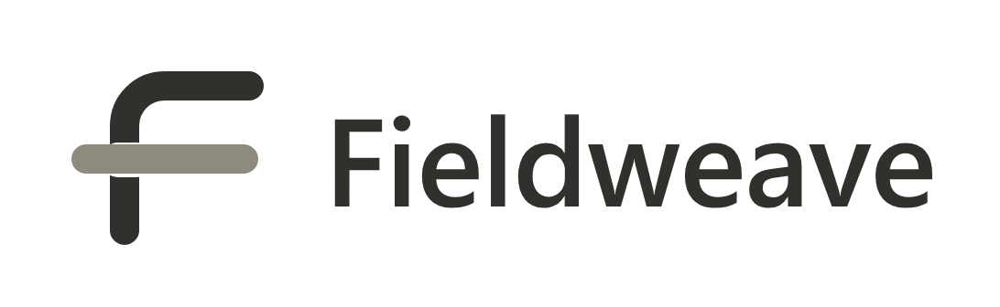

<p align="center">
  
</p>

<h1 align="center">Fieldweave</h1>

<p align="center">面向跨学科科研协作的本地生成式 AI 原型</p>

<p align="center">
  
  
  
  
</p>

## 项目简介

Fieldweave 是一个可以在本机运行的跨学科科研协作 Web 原型，重点解决跨学科合作中的“语言不通”和“方法不知”两个问题

平台以医学影像 × 计算机视觉、传染病传播 × 统计学、金融风险 × 数据科学三个案例作为演示场景，提供术语对齐、观点对照、方法推荐、文献采集和知识库管理能力

项目强调本地优先、来源可追溯和人工确认，适合课题演示、原型验证和后续研究扩展

## 核心能力

- **跨学科术语对齐**：选择源学科和目标学科，输入术语或研究问题，输出对应概念、共同点、差异、条件和局限
- **观点对照**：输出两个学科视角之间的共识、冲突、互补和协调建议
- **方法推荐**：基于本地知识库进行 BM25 风格检索，结合同义词、主题和方法名匹配，单次最多返回 6 条结果
- **证据与引用**：回答和跨学科分析会引用本地条目，并过滤模型编造的条目编号
- **人工确认**：对齐结果可以保存为待核对、已采纳或已驳回，支持修改目标概念、关系说明和人工备注
- **AI 与人工结果分离**：保存模型原始结果和人工修订结果，发生修改后可查看差异
- **知识库覆盖图**：按案例统计研究任务覆盖数、目标数和缺口
- **文献采集**：支持 Europe PMC、Crossref、OpenAlex、arXiv 和 Zenodo
- **候选条目生成**：可用模型从论文标题、摘要和全文分节生成待核对条目，审核后合并进工作台覆盖层
- **项目与对话**：项目、聊天、附件、搜索、导出、回收站和自动备份
- **多模型接入**：DeepSeek、OpenAI、Claude、Gemini 和 OpenAI 兼容接口
- **本地运行**：无第三方 Python 运行时依赖，支持 Windows 和 macOS

## 技术架构

```text
浏览器
  │ HTTP 127.0.0.1:8765
  ▼
Python 标准库 HTTP 服务
  ├─ ask / search / knowledge
  ├─ alignment
  ├─ literature
  ├─ model_providers
  └─ workspace_store
        ├─ data/workspace.sqlite3
        └─ data/knowledge-base.sqlite3（只读）
```

- 后端只使用 Python 标准库，SQLite 直接由 Python 内置模块访问
- 前端是普通 HTML、CSS 和经典脚本，页面由 Python 服务直接提供
- `frontend/` 只在修改前端源码时需要 Node 构建，日常运行不依赖 Node
- 模型密钥只保存在当前本地服务进程中，不写入数据库

更完整的模块说明见 [docs/architecture.md](docs/architecture.md)

## 快速开始

### 环境要求

- Python 3.10 或更新版本
- Windows 或 macOS
- 可选：Node.js 仅用于重新构建前端

项目不需要 `pip install`

### Windows

双击 `Start.cmd`，或在项目目录运行：

```powershell
py -3 -B src/app.py --open
```

### macOS

首次使用先赋予执行权限：

```bash
chmod +x Start.command Test.command
```

然后双击 `Start.command`，或在终端运行：

```bash
./Start.command
```

如果 macOS 提示无法验证开发者，右键点击 `Start.command` 并选择「打开」

### 打开页面

服务启动后访问：

```text
http://127.0.0.1:8765/
```

首次运行会自动创建 `data/workspace.sqlite3`，不需要手动初始化数据库

运行期间请保留启动窗口，按 `Ctrl+C` 停止服务

### 常用参数

```bash
# 更换端口
./Start.command --port 8766

# 输出请求日志
./Start.command --verbose

# 指定另一个工作台数据库
./Start.command --workspace /path/to/workspace.sqlite3
```

Windows 下把 `./Start.command` 换成 `.\Start.cmd`

## 使用指南

1. 打开输入框右下角的模型菜单，进入「API 设置」，选择供应商并填写模型 ID 和 API Key
2. 没有配置模型时仍可使用本地知识库检索，术语对齐和观点对照需要配置模型
3. 在「从示例开始」选择案例，或直接在输入框提问
4. 点击左侧「跨学科对齐」，选择源学科、目标学科和分析类型，输入术语、问题或观点
5. 在结果中查看概念对应、差异、共识、冲突、互补和建议，并完成人工确认
6. 点击左侧「文献与数据」采集论文或数据集，可使用「批量扩展」补充文献量
7. 在文献详情生成候选条目，在「待核对条目」中审核、合并或回滚
8. 在项目概览查看聊天、资料、候选条目和知识覆盖情况

### 引用格式

回答支持以下引用格式：

```text
[MED-04]
【MED-04】
[MED-04, MED-07]
```

模型引用不存在的条目时，系统会过滤这些引用，并继续展示本地检索结果

## 目录结构

| 路径 | 作用 |
|---|---|
| `src/app.py` | HTTP 服务、问答编排、对齐接口和页面入口 |
| `src/model_providers.py` | 模型供应商配置与请求格式 |
| `src/workspace_store.py` | 项目、聊天、附件、候选条目、对齐记录和工作台数据库 |
| `src/literature.py` | 文献、数据集和开放全文采集 |
| `src/search.py` | 分词、同义词扩展和检索排序 |
| `src/knowledge.py` | 案例、概念映射、覆盖任务和证据结构 |
| `src/knowledge_config.json` | 案例、映射、覆盖任务和论文链接配置 |
| `src/client/app*.js` | 手写前端交互脚本 |
| `frontend/` | React 模板、shadcn/ui 组件、Tailwind 主题和构建脚本 |
| `dist/` | 构建产物 `index.html` 和 `styles.css` |
| `tests/` | 不访问网络的单元测试 |
| `assets/branding/` | Logo、图标和品牌资源 |
| `Start.cmd` / `Test.cmd` | Windows 启动与测试入口 |
| `Start.command` / `Test.command` | macOS 启动与测试入口 |
| `data/knowledge-base.sqlite3` | 只读示例知识库，包含 30 条证据条目 |
| `data/workspace.sqlite3` | 本机工作台数据库，首次运行自动创建，已被 Git 忽略 |
| `docs/` | 架构、接口和项目文档 |
| `.github/workflows/tests.yml` | Windows 和 macOS 的 GitHub Actions 测试 |

## 主要接口

<details>
<summary>展开完整接口列表</summary>

### 问答与知识库

| 接口 | 用途 |
|---|---|
| `GET /api/cases` | 返回案例、条目数、示例问题和模型配置状态 |
| `POST /api/ask` | 提交案例、模式和研究问题，返回回答、结果和引用 |
| `GET /api/knowledge?case=MED` | 获取案例条目，可加 `include_inactive=1` |
| `GET /api/coverage?case=MED` | 获取任务覆盖计数和缺口 |
| `GET /api/settings/model` | 查询供应商、模型和思考档位 |
| `POST /api/settings/model` | 保存、切换或清除模型配置 |
| `POST /api/settings/model/test` | 测试模型连接 |

### 跨学科对齐

| 接口 | 用途 |
|---|---|
| `GET /api/alignment` | 列出最近的对齐记录 |
| `POST /api/alignment` | 比较两个学科，需要 `source_case`、`target_case`、`task` 和 `input` |
| `GET /api/alignment/{id}` | 查看单条记录、AI 原始结果和人工确认状态 |
| `POST /api/alignment/{id}/review` | 保存人工确认、备注和修订后的概念/关系 |

### 文献与数据

| 接口 | 用途 |
|---|---|
| `GET /api/literature?case=MED&kind=article` | 获取论文或数据集列表 |
| `POST /api/literature/collect` | 从公开来源采集并入库 |
| `POST /api/literature/expand` | 按案例主题跨来源批量扩展 |
| `GET /api/literature/{id}` | 查看文献或数据集详情 |
| `POST /api/literature/{id}/fulltext` | 采集开放论文全文 |
| `POST /api/literature/{id}/candidates` | 从论文生成待核对候选条目 |
| `GET /api/literature/export?case=MED&kind=article` | 导出原始文献记录 |

### 工作台

| 接口 | 用途 |
|---|---|
| `GET /api/workspace` | 获取项目、聊天和文件索引 |
| `GET /api/workspace/export` | 导出工作台 JSON |
| `GET /api/workspace/search?q=肝脏` | 搜索聊天内容 |
| `POST /api/workspace/chats/{id}/pin` | 置顶或取消置顶聊天 |
| `POST /api/workspace/chats/{id}/move` | 移动聊天到项目 |
| `POST /api/workspace/chats/{id}/remove` | 把聊天移到回收站 |
| `POST /api/workspace/chats/{id}/restore` | 恢复聊天 |
| `POST /api/workspace/chats/{id}/purge` | 永久删除聊天 |
| `GET /api/workspace/trash` | 查看回收站 |
| `GET /api/workspace/projects/{id}/report` | 导出项目报告 Markdown |

### 候选条目与知识覆盖层

| 接口 | 用途 |
|---|---|
| `GET /api/workspace/candidates` | 列出候选条目 |
| `POST /api/workspace/candidates` | 创建候选条目 |
| `POST /api/workspace/candidates/{id}/review` | 审核候选条目 |
| `POST /api/workspace/candidates/{id}/remove` | 移除候选条目 |
| `GET /api/workspace/candidates/export` | 导出候选条目 |
| `POST /api/workspace/knowledge/entries/{id}` | 编辑工作台知识条目 |
| `POST /api/workspace/knowledge/entries/{id}/active` | 启用或停用知识条目 |
| `POST /api/workspace/knowledge/entries/{id}/remove` | 移出工作台覆盖层 |
| `GET /api/workspace/knowledge/versions` | 查看版本差异 |
| `POST /api/workspace/knowledge/merge` | 合并已通过候选 |
| `POST /api/workspace/knowledge/rollback` | 回滚知识版本 |

</details>

案例编号为 `MED`、`EPI`、`FIN`，问答模式为 `auto`、`method` 或 `concept`

## 知识库配置

案例、概念映射、覆盖任务和论文链接都保存在 `src/knowledge_config.json`

`coverage` 中每个任务包含：

- `key`：任务唯一标识
- `label`：显示名称
- `keywords`：匹配关键词
- `target`：目标条目数

关键词会匹配研究场景、概念、方法、理由、条件和局限，ASCII 关键词按整词匹配

新增案例时需要同步补充对应的 `coverage` 任务，服务启动时会校验配置

## 测试

Windows：

```powershell
py -3 -B -m unittest discover -s tests -v
```

macOS：

```bash
python3 -B -m unittest discover -s tests -v
```

也可以双击 `Test.cmd` 或 `Test.command`

当前测试数量为 98，全部测试不访问网络

测试覆盖检索排序、同义词、方法去重、覆盖任务、引用核对、工作台增删改查、聊天重命名、附件词表、会话搜索、候选审核、跨学科对齐、证据过滤、人工修订、知识版本、回收站、项目报告、自动备份、PDF 文本提取、图片原文、侧栏排序、文献解析和数据库迁移

GitHub Actions 配置在 `.github/workflows/tests.yml`，会在 Windows 和 macOS 上运行测试

## 前端开发

只有修改 `frontend/` 或 `src/client/` 时才需要重新构建页面

```bash
cd frontend
npm ci
npm run build
```

构建会生成：

```text
dist/index.html
dist/styles.css
```

`src/client/*.js` 是手写脚本，不参与构建，由 Python 服务直接提供

## 数据与隐私

- 服务默认只监听 `127.0.0.1`，不对外开放
- `data/workspace.sqlite3` 保存本机项目、聊天、附件和对齐记录，已被 `.gitignore` 忽略
- 原始知识库以只读方式打开，不会被工作台修改
- 网页填写的 API Key 只保存在当前服务进程内，不写入数据库
- 启用云端模型后，问题、有限上下文和命中的知识条目会发送给对应模型供应商
- 服务启动时会自动把工作台备份到 `data/.backups/`，默认保留最近 10 份
- 附件支持 PDF、DOCX、CSV、TSV、TXT、Markdown、PNG、JPEG 和 WebP，单个文件最大 5 MB
- 当前没有接入图片 OCR，图片内容不参与检索

## 平台支持

| 平台 | 启动 | 测试 |
|---|---|---|
| Windows 10/11 | `Start.cmd` | `Test.cmd` |
| macOS | `Start.command` | `Test.command` |

macOS 启动脚本会查找 Homebrew、`/usr/local/bin` 和系统 `python3`，并要求 Python 3.10 以上

## 已知限制

- 当前是单用户本地原型，没有账号、权限和多人实时协作
- 成员能力画像、成员匹配和方案共创尚未实现
- 跨学科对齐依赖模型，未配置模型时只能查看历史记录
- 文献采集、全文下载和批量扩展需要联网
- 图片 OCR、语音和视频处理尚未接入
- 目前只提供本地部署，没有云端部署配置

## 后续方向

- 增加成员画像、技能标签和任务匹配
- 增加研究方案共创画布和团队决策记录
- 增加真实用户任务评估和效果统计
- 扩展知识库条目和跨学科概念映射
- 提供容器化部署和更完整的权限模型

## 参考与致谢

- 上游组件来自 [shadcn/ui](https://github.com/shadcn-ui/ui)
- 对话布局参考 [Unsloth Studio](https://unsloth.ai/docs/new/studio/chat)
- 聊天归档和资料预览交互参考 [Open WebUI](https://github.com/open-webui/open-webui)
- 文献来源包括 Europe PMC、Crossref、OpenAlex、arXiv 和 Zenodo

## 仓库协作

本仓库用于课题组内部协作、课程展示和原型评审，默认不公开

课题组成员需要 GitHub 账号，并由负责人在仓库 `Settings → Collaborators` 中邀请

建议权限：

- 开发成员：Write
- 导师和评审：Read
- 课题负责人：Admin

协作者克隆仓库后按「快速开始」运行即可

请勿提交 `data/workspace.sqlite3`、`data/.backups/`、API Key 或未公开研究数据

## 使用范围与许可

本项目为课题组研究、课程展示和原型验证用途

代码、文档、示例数据和品牌资源的版权归课题组及作者所有

未经课题组书面许可，不得复制、修改、分发、公开部署或用于商业用途

仓库可见不等于开源授权

如需合作、评审或后续使用，请联系课题负责人

如需将项目开源，应由课题组和学校确认后另行补充 `LICENSE` 文件

第三方组件继续遵循各自许可证，详见 `frontend/SHADCN-LICENSE.md`

论文标题、摘要、来源链接和采集数据遵循原论文或数据源许可

Fieldweave 名称和 Logo 不随代码或数据授权
